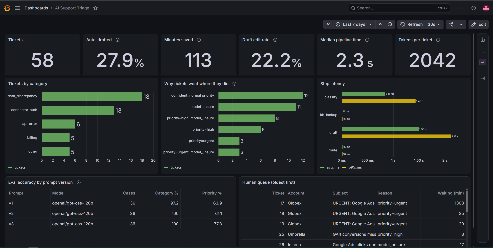
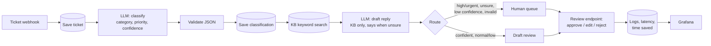

# AI Support Ticket Triage

An AI agent that triages support tickets for a marketing data platform: it classifies each ticket, finds relevant help articles, drafts a reply, and routes it to the right queue. **Nothing is ever sent automatically.** A human approves, edits or rejects every draft, and every step is logged and measured.

Built with n8n, Postgres and Grafana, all self-hosted in one `docker-compose.yml`. The LLM runs on Groq (`openai/gpt-oss-120b`), but the pipeline is model-agnostic: swapping models is a one-node change.




## The problem

Support teams at marketing data platforms see the same ticket types every day: "Meta spend doesn't match Ads Manager", "Google Ads connector says invalid_grant", "GA4 conversions are missing". Each one needs to be read, categorised, prioritised, matched to the right help article and answered. That's 10 to 20 minutes of agent time per ticket before any real investigation starts.

The risky part isn't speed, it's priority. A broken pipeline sitting in a normal queue means a customer's dashboards are wrong all day.

## How it works



1. **Ingest:** a webhook receives the ticket and stores it in Postgres with the raw payload.
2. **Classify:** the LLM returns category, priority, confidence and a one-line reason. Output is forced into a strict JSON schema, then validated again in code. Invalid output is flagged, never trusted, and the ticket goes to a human.
3. **KB lookup:** Postgres full-text search over help articles, with a boost for articles in the same category.
4. **Draft:** the LLM writes a reply using only the KB articles it was given. If they don't cover the issue, it says so (`is_unsure`) instead of guessing, and asks for the specific details needed.
5. **Route:** high or urgent priority, an unsure drafter, low confidence or invalid output goes to the human queue. Everything else becomes a draft waiting for an agent.
6. **Review:** a separate endpoint lets an agent approve as-is, approve with edits, or reject. Whether the draft was edited is tracked automatically.
7. **Measure:** latency and tokens per step, routing reasons, edit rate and estimated time saved, all queryable in SQL and shown in Grafana.

## Results

### Eval: 36 labelled tickets, 3 prompt versions

I wrote 36 realistic tickets across all 5 categories, including deliberately tricky ones (an auth error that looks like an API error, a vague "numbers look weird", a ticket with two issues). Each prompt version runs the full set through an n8n eval workflow and gets scored in SQL.

| Prompt | Change | Category | Priority | Too high | Too low | Critical tickets downgraded |
|---|---|---|---|---|---|---|
| v1 | Baseline | 97.2% | 63.9% | 12 | 1 | 0 |
| v2 | "Start from normal, escalate only with evidence" | 100% | 61.1% | 2 | 12 | 9 |
| v3 | Priority defined by impact: "is data still flowing, will it recover?" Ties go up | **100%** | **77.8%** | 6 | 2 | **0** |

What I learned:

- **The overall score hides the direction of mistakes.** v1 over-escalated almost everything, which sends most tickets to humans and kills the automation. v2 fixed that by overcorrecting: its score barely moved, but it downgraded 9 genuinely broken pipelines. That's the dangerous failure, so I started tracking too-high and too-low separately.
- **Describe impact, not surface features.** v2 said "an error message alone is not high", so the model downgraded real outages. v3 asks whether the customer's data is still flowing, which generalises better.
- **Errors aren't symmetric.** An extra human review costs a few minutes. A missed outage costs a customer's trust. v3 deliberately breaks ties upwards.
- **Labels can be wrong too.** After v3, I reviewed every miss and asked "is the model wrong or is my label wrong?" One label was inconsistent with my own rubric (#24, auth failing on every run, labelled normal while a similar ticket was high). I fixed it with a written reason, and all runs were rescored against the corrected label.
- **I stopped at v3.** Tuning further against the same 36 tickets mostly overfits. The proper next step is a held-out test set the prompt has never seen.

### Live pipeline (synthetic demo traffic)

| Metric | Value |
|---|---|
| Median time, ticket received to draft saved | ~2.3 s |
| Slowest step | Drafting, ~1.5 s average, ~2.1 s p95 |
| Tokens per ticket (classify + draft) | ~2,000 |
| Tickets auto-drafted (not sent to human queue) | ~28% |
| Approved drafts edited by the agent | ~22% |
| Estimated time saved per approved draft | ~12.5 min |

### The most useful finding: the bottleneck is the knowledge base, not the AI

In a demo run of 43 tickets, the drafter flagged `model_unsure` on **51%** of them. For 11 tickets it was the *only* reason they went to a human. The KB has just 6 articles, so the drafter correctly refuses to guess.

That means automation could roughly double (about 28% to 53%) **without touching the model**, just by writing help articles for the gaps. The "why tickets went where they did" panel shows exactly which gaps to fill first.

Second finding: **the confidence threshold never fired once.** The model reports 0.93 to 0.98 confidence on everything, including a ticket that just says "numbers look weird". Self-reported LLM confidence is poorly calibrated, so routing relies on priority and the drafter's `is_unsure` flag instead.

## How time saved is calculated

`v_time_saved` compares a manual baseline per category (triage + writing a reply) against the time to review a draft (as-is or edited). **The baseline minutes in `handling_baselines` are my estimates**, based on handling ~100 inbound conversations a week as a retention team lead. They're assumptions to be replaced with real handle-time data from a helpdesk.

## Design decisions

- **Never auto-send.** Every draft needs a human decision. The AI saves time on reading, categorising and writing, not on judgment.
- **Strict schema plus code validation.** The LLM is forced into a JSON schema, and a code node re-checks every field. Bad output gets flagged and routed to a human instead of crashing the flow.
- **Keep every attempt.** Classifications store the raw response, model and prompt version, so a new prompt never overwrites history.
- **Least privilege.** Three database roles: n8n's internal storage, the workflows (read/write), and Grafana (read-only). Ports are bound to localhost only.
- **Parameterised SQL everywhere.** Ticket text never gets concatenated into queries.
- **Model-agnostic.** The project started on Gemini and moved to Groq after hitting the Gemini free tier's 20 requests/day limit mid-eval. Only the HTTP node and the response parser changed.
- **Dashboard as code.** The Grafana dashboard and datasource are provisioned from files in this repo.

## Run it yourself

Requirements: Docker Desktop and a free [Groq API key](https://console.groq.com).

```bash
git clone https://github.com/Gabbrriell/ai-support-triage.git
cd ai-support-triage
cp .env.example .env        # replace every change-me with a random string
docker compose up -d
```

Then:

1. Open n8n at http://localhost:5678 and create an account.
2. Import the three workflows from `Workflows/`.
3. Create two credentials:
   - **Postgres:** host `postgres`, database `support`, user `triage_app`, password `APP_DB_PASSWORD` from `.env`
   - **Header Auth:** name `Authorization`, value `Bearer <your Groq key>`
4. Attach them to the Postgres and HTTP Request nodes, then publish **Ticket triage** and **Review draft**.
5. Load the eval set and send demo traffic (PowerShell):
   ```powershell
   Get-Content db\seed\eval_cases.sql | docker compose exec -T postgres psql -U postgres -d support
   powershell -ExecutionPolicy Bypass -File scripts\seed-demo.ps1
   powershell -ExecutionPolicy Bypass -File scripts\review-demo.ps1
   ```
6. Open Grafana at http://localhost:3000, then **Dashboards > AI Support Triage**.

Send a single ticket:

```powershell
$body = @{ subject = "Google Ads connector says invalid_grant"; body = "Extractions failing since Monday."; customer_email = "you@example.com"; account_name = "Acme" } | ConvertTo-Json
Invoke-RestMethod -Uri http://localhost:5678/webhook/ticket -Method Post -Body $body -ContentType "application/json"
```

## Repo structure

```
docker-compose.yml          Postgres (pgvector), n8n, Grafana
db/init/                    roles, schema, starter KB (runs on first start)
db/seed/eval_cases.sql      36 labelled eval tickets
Workflows/                  n8n exports: Ticket triage, Eval runner, Review draft
grafana/provisioning/       datasource + dashboard as code
scripts/                    demo traffic + simulated agent reviews
```

## Limitations

- **Demo data is synthetic.** Live metrics come from the eval tickets replayed as traffic and simulated reviews, not real customers.
- **The eval set is small and was used for tuning.** 36 tickets, labelled by one person, with prompts iterated against the same set.
- **Time-saved baselines are estimates**, see above.
- **Webhooks have no authentication.** Fine on localhost; production needs header auth or signature verification.
- **The classify prompt exists in two places** (live flow and eval runner) and has to be kept in sync by hand.
- **KB search is keyword-only**, so it misses synonyms ("spend" vs "cost").

## Next steps

1. **Grow the KB** from the `model_unsure` tickets. That's the biggest automation lever.
2. **Held-out test set** labelled by a second person, to measure real generalisation and label agreement.
3. **Semantic KB search** with pgvector (the `embedding` column is already in the schema).
4. **Better routing signal than self-reported confidence**, e.g. agreement between two classification runs.
5. **Single source for prompts**, with an n8n sub-workflow shared by the live flow and the eval runner.
6. **Real helpdesk integration** (Zendesk or Freshdesk webhooks in, drafts posted back as internal notes).
7. **MCP server over the ticket database**, so Claude Code can answer "what were the top issues this week?"
